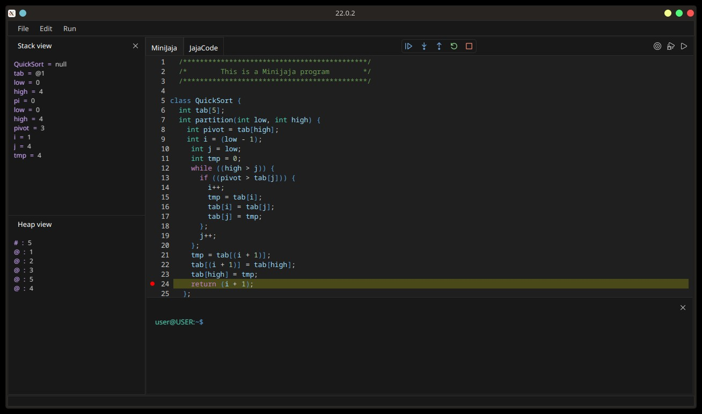
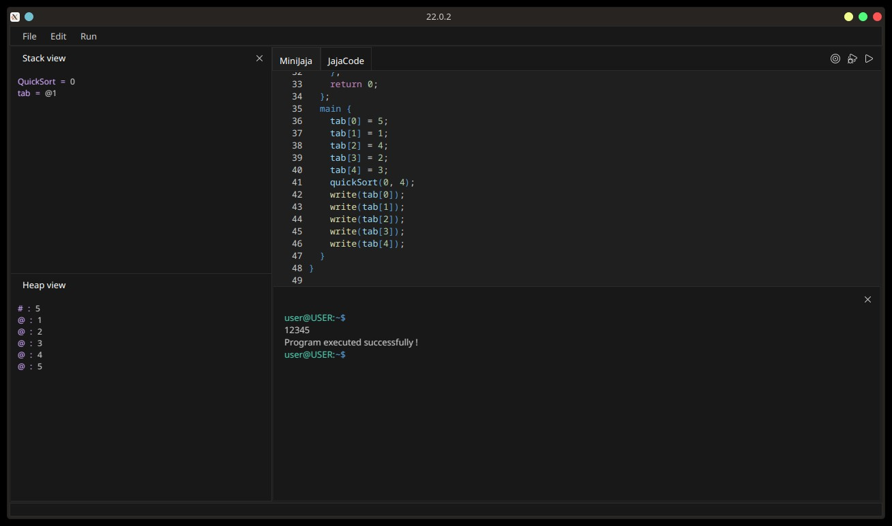
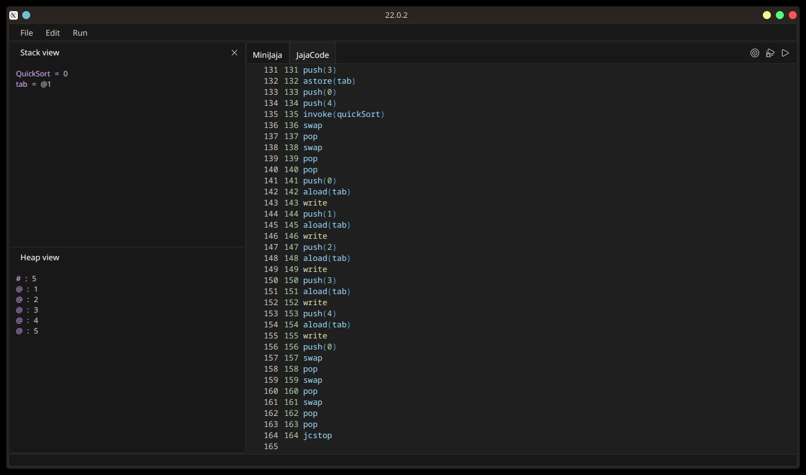
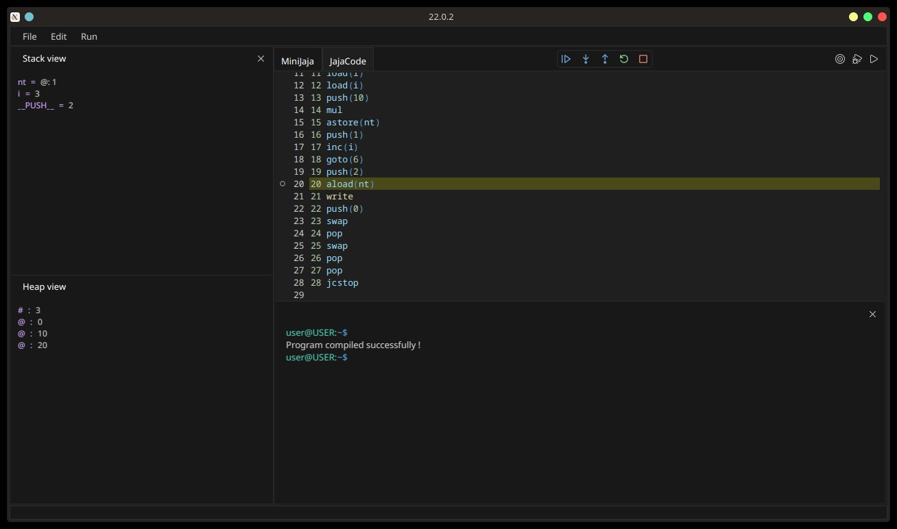
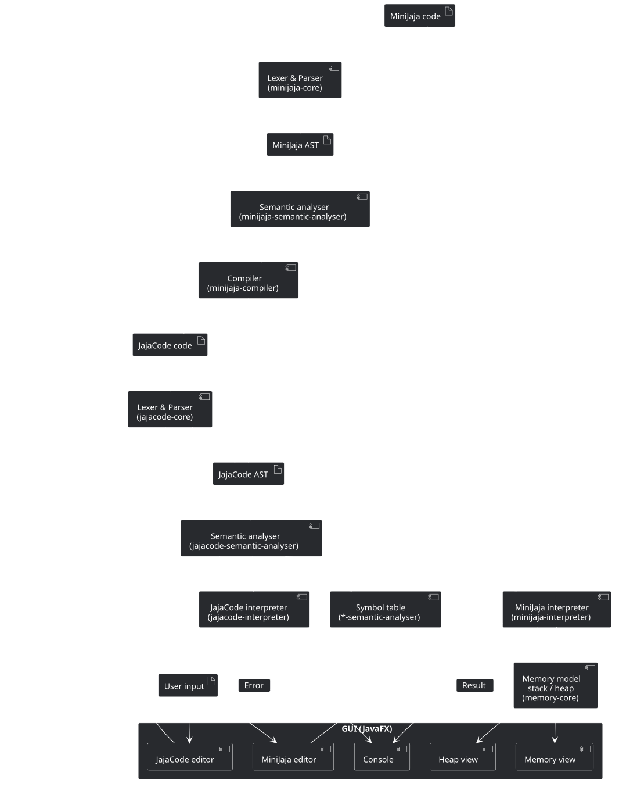

# MiniJaja IDE

A desktop IDE for **MiniJaja**, a statically typed, Java-like teaching language, with a compiler to bytecode, an interpreter, a semantic analyser and a step-by-step debugger.



## Features

- **Editor** for both MiniJaja source and JajaCode bytecode
- **Compiler** with a full pipeline: parsing, semantic analysis, and JajaCode generation
- **Semantic analysis** catching type errors, undeclared variables, and invalid method calls before execution
- **Two ways to run a program:** interpret MiniJaja directly, or compile and execute the JajaCode
- **Step-by-step debugger** with breakpoints, on both MiniJaja and JajaCode
- **Live memory inspector** showing the stack and heap at every step
- **Output console** for `write` / `writeln` and compile/runtime messages

Built with Java, JavaFX, and ANTLR4.

## Getting started

### Prerequisites

- Java 11+
- Maven 3.6+

### Build and run

```bash
git clone https://github.com/massylamarni/minijaja-compiler.git
cd minijaja-compiler
mvn clean install
mvn javafx:run -pl gui
```

## Usage

### 1. Write and run a program

Write a program in the **MiniJaja** tab, then run it. The output appears in the console at the bottom.



### 2. Inspect the compiled bytecode

The **JajaCode** tab shows the bytecode generated from your program.



### 3. Debug

Set a breakpoint by clicking the gutter, start the debugger, and step through the code. The **Stack view** and **Heap view** update at every step, whether you are debugging MiniJaja or JajaCode.



## Example

<table>
<tr><th>MiniJaja</th><th>JajaCode</th></tr>
<tr><td>

```java
class Factorial {
    int factorial(int n) {
        if (n == 0) {
            return 1;
        } else {
            return n * factorial(n - 1);
        };
    };
    main {
        int result = factorial(5);
        write(result);
    }
}
```

</td><td>

```nasm
1 init
2 push(5)
3 new(factorial, entier, meth, 0)
4 goto(22)
5 new(n, entier, var, 1)
6 load(n)
...
29 push(0)
30 swap
31 pop
32 swap
33 pop
34 pop
35 jcstop
```

</td></tr>
</table>

<details>
<summary>Full JajaCode listing</summary>

```nasm
1 init
2 push(5)
3 new(factorial, entier, meth, 0)
4 goto(22)
5 new(n, entier, var, 1)
6 load(n)
7 push(0)
8 cmp
9 if(19)
10 load(n)
11 load(n)
12 push(1)
13 sub
14 invoke(factorial)
15 swap
16 pop
17 mul
18 goto(20)
19 push(1)
20 swap
21 return
22 push(5)
23 invoke(factorial)
24 swap
25 pop
26 new(result, entier, var, 0)
27 load(result)
28 write
29 push(0)
30 swap
31 pop
32 swap
33 pop
34 pop
35 jcstop
```

</details>

## Language overview

**MiniJaja** supports:

- Types: `int`, `boolean`
- Variables, constants (`final`), and arrays
- Methods with parameters and return values
- Control flow: `if / else`, `while`
- Arithmetic, logical, comparison, and unary expressions
- I/O: `write`, `writeln`
- Single-class programs with a `main` block

See [docs/minijaja.md](docs/minijaja.md) for more.

**JajaCode** is the stack-based bytecode MiniJaja compiles to:
`new`, `newarray`, `load/store`, `aload/astore`, `push/pop`, `invoke`, `return`, `goto`, `if`, `inc`, `write/writeln`, plus arithmetic and logic operators.

See [docs/jajacode.md](docs/jajacode.md) for more.
Also see [docs/grammar.md](docs/grammar.md) for the full grammar and instruction set.

## Architecture


